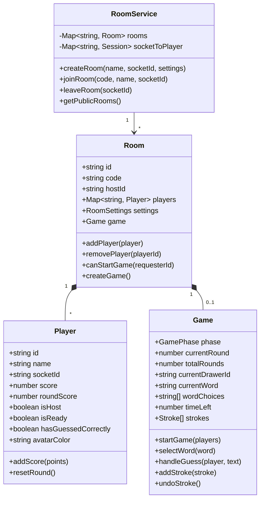
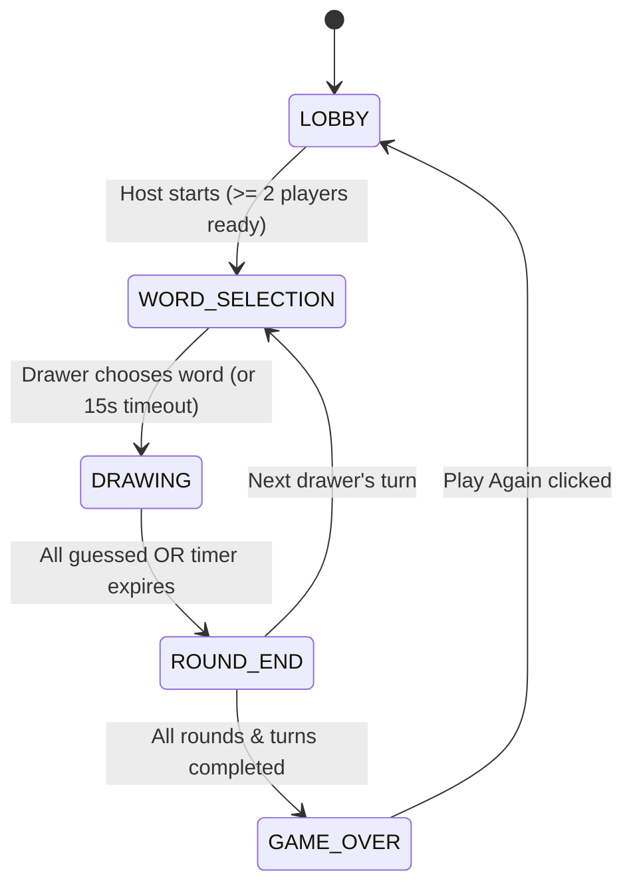

# 🎨 Skribble – Real-Time Multiplayer Drawing and Guessing Game

A production-quality, real-time multiplayer drawing and guessing game inspired by Skribbl.io. Built with **React**, **TypeScript**, **Vite**, **Tailwind CSS**, **Node.js**, **Express**, and **Socket.IO**.

[](LICENSE)
[](https://www.typescriptlang.org/)
[](https://socket.io/)
[](https://tailwindcss.com/)

---

## 🌟 Live Demo & Deployment

- **Frontend (Render Static Site):** `https://skribble-client.onrender.com` *(placeholder)*
- **Backend (Render Web Service):** `https://skribble-server.onrender.com` *(placeholder)*

---

## 📖 Table of Contents

1. [Features](#-features)
2. [Tech Stack](#-tech-stack)
3. [System Architecture](#-system-architecture)
4. [Project Structure](#-project-structure)
5. [Real-Time Socket.IO Protocol](#-real-time-socketio-protocol)
6. [Game Lifecycle & Round Flow](#-game-lifecycle--round-flow)
7. [Fair Scoring System](#-fair-scoring-system)
8. [Drawing Engine & Canvas Sync](#-drawing-engine--canvas-sync)
9. [Security & Validation](#-security--validation)
10. [Local Development & Setup](#-local-development--setup)
11. [Deployment Guide (Render)](#-deployment-guide-render)
12. [Automated Verification & Testing](#-automated-verification--testing)
13. [Future Enhancements](#-future-enhancements)

---

## ✨ Features

- **Real-Time Synchronized Drawing:** HTML5 Canvas with normalized `[0, 1]` vector coordinates, sub-pixel smoothness via quadratic bezier curves, dynamic brush sizes, color palette, eraser, synchronized undo, and clear.
- **Authoritative Server State:** Server-authoritative game phases, rounds, timers, and stroke history. Non-drawers are strictly prevented from emitting canvas modifications.
- **Categorized Word Database:** Rich vocabulary across 8 distinct categories (*Animals, Food, Objects, Technology, Nature, Sports, Places, Daily Activities*).
- **Progressive Hint Engine:** Server gradually unmasks characters at configurable intervals without spoiling answers.
- **Intelligent Guess Detection & Anti-Spoil Chat:**
  - Case-insensitive, whitespace-normalized guess evaluation.
  - Levenshtein distance calculation to privately notify players when their guess is close.
  - Automatically suppresses guessed words from chat so subsequent guessers cannot copy.
  - Blocks drawers from writing the secret word into chat.
- **Web Audio Sound Effects:** Zero external audio assets—sound synthesis implemented entirely with the HTML5 Web Audio API (correct guess chimes, urgent timer ticks, turn notifications, game-over fanfares).
- **Audio & Visual Celebration:** Confetti particle system and responsive 1st/2nd/3rd winner podium.
- **Responsive Modern UI:** Modern design system built with Tailwind CSS, supporting desktop multi-column layouts and responsive mobile/tablet tab views.
- **Persistent Player Identity:** Identity management via `sessionStorage` preventing accidental disconnection on page refreshes.
- **Public & Private Rooms:** Unique 6-character room codes, 1-click shareable invite links, and a real-time public room browser.

---

## 🛠 Tech Stack

### Frontend
- **React 19** & **TypeScript** (Strict mode)
- **Vite 8** (Lightning-fast HMR and bundling)
- **Tailwind CSS 3** (Custom design tokens, soft neutral styling, responsive layouts)
- **Lucide React** (Clean, consistent iconography)
- **React Router 7** (Client-side routing)
- **Canvas Confetti** (Podium celebration)
- **HTML5 Canvas & Web Audio API** (Vector rendering & audio synthesis)

### Backend
- **Node.js 24** & **Express.js**
- **TypeScript** (`NodeNext` module resolution)
- **Socket.IO 4** (WebSockets with polling fallback)
- **dotenv** & **cors**

---

## 🏗 System Architecture

The backend follows an **Object-Oriented Architecture** isolating domain rules from transport protocols:



---

## 📂 Project Structure

```
skribble/
├── client/
│   ├── src/
│   │   ├── components/
│   │   │   ├── canvas/
│   │   │   │   └── DrawingCanvas.tsx       # Canvas element, vector rendering & tools
│   │   │   ├── chat/
│   │   │   │   └── ChatBox.tsx             # Live chat, guess input & announcements
│   │   │   └── game/
│   │   │       ├── GameHeader.tsx          # Timer, round info & word display
│   │   │       ├── PlayerList.tsx          # Real-time ranking & player indicators
│   │   │       ├── WordSelectionModal.tsx  # Drawer word selection dialog
│   │   │       ├── RoundEndModal.tsx       # Secret word reveal & round scoring
│   │   │       └── GameOverModal.tsx       # Winner announcement & 3D-styled podium
│   │   ├── context/
│   │   │   └── GameContext.tsx             # Global game state & Socket.IO hooks
│   │   ├── pages/
│   │   │   ├── HomePage.tsx                # Landing page, room browser, how-to-play
│   │   │   ├── CreateRoomPage.tsx          # Custom match configuration
│   │   │   ├── JoinRoomPage.tsx            # Room code & direct invite handling
│   │   │   ├── LobbyPage.tsx               # Player grid, ready check & host controls
│   │   │   └── GamePage.tsx                # Main responsive 3-pane game screen
│   │   ├── socket/
│   │   │   └── socket.ts                   # Socket.IO client initialization
│   │   ├── types/
│   │   │   └── index.ts                    # Shared TypeScript interfaces
│   │   ├── utils/
│   │   │   ├── canvas.ts                   # Normalized coordinate math & curves
│   │   │   ├── sound.ts                    # Web Audio API sound synthesizer
│   │   │   └── storage.ts                  # Persistent session identity storage
│   │   ├── App.tsx
│   │   ├── index.css
│   │   └── main.tsx
│   ├── package.json
│   ├── tailwind.config.js
│   └── vite.config.ts
│
├── server/
│   ├── src/
│   │   ├── classes/
│   │   │   ├── Game.ts                     # Round state machine, turn queues, timers
│   │   │   ├── Player.ts                   # Player scores, status, avatars
│   │   │   └── Room.ts                     # Membership, privacy, lifecycle
│   │   ├── data/
│   │   │   └── words.json                  # Categorized word database (8 categories)
│   │   ├── handlers/
│   │   │   ├── chatHandler.ts              # Guess validation & chat rate-limiting
│   │   │   ├── drawingHandler.ts           # Stroke broadcast & authorizer
│   │   │   ├── gameHandler.ts              # Game start, word pick, lifecycle
│   │   │   └── roomHandler.ts              # Room creation, joining, ready toggles
│   │   ├── services/
│   │   │   ├── roomService.ts              # Active rooms & player socket maps
│   │   │   └── wordService.ts              # Word selection & hint masking engine
│   │   ├── types/
│   │   │   └── index.ts                    # Server types and Socket event contracts
│   │   ├── utils/
│   │   │   ├── codeGenerator.ts            # Collision-free 6-char room codes
│   │   │   └── sanitize.ts                 # Input sanitization & anti-XSS
│   │   └── index.ts                        # Express & Socket.IO server entry
│   ├── package.json
│   └── tsconfig.json
│
├── scripts/
│   ├── test-gameplay.js                    # Automated multi-client test suite
│   └── test-full-game.js                   # End-to-end multi-round lifecycle test
├── render.yaml                             # Render infrastructure-as-code
├── package.json                            # Monorepo root workspace configuration
└── README.md
```

---

## 📡 Real-Time Socket.IO Protocol

### Client to Server Events
| Event | Payload | Description |
|---|---|---|
| `create_room` | `{ playerName, settings, playerId }` | Creates a room and registers the caller as host |
| `join_room` | `{ roomCode, playerName, playerId }` | Joins a room by code |
| `player_ready` | `boolean` | Toggles player readiness |
| `start_game` | `void` | Host triggers match start |
| `select_word` | `string` | Current drawer selects secret word |
| `draw_start` | `{ strokeId, tool, color, size, point: {x,y} }` | Drawer initiates stroke |
| `draw_move` | `{ strokeId, points: [{x,y}] }` | Drawer streams batched stroke points |
| `draw_end` | `{ strokeId }` | Finalizes stroke and persists to server history |
| `draw_undo` | `void` | Drawer undoes last stroke |
| `canvas_clear` | `void` | Drawer wipes canvas |
| `chat_message` | `{ message: string }` | Sends guess or chat message |
| `play_again` | `void` | Host restarts room for another match |

### Server to Client Events
| Event | Payload | Target | Description |
|---|---|---|---|
| `room_updated` | `RoomData` | Room | Synchronizes room & player roster |
| `game_state` | `PublicGameState` | Room | Broadcasts phase, timer, and masked word |
| `word_choices` | `string[]` | **Drawer Only** | Delivers 3 secret word options |
| `current_drawer_word`| `string` | **Drawer Only** | Delivers selected word to drawer |
| `draw_start` | `DrawStartPayload`| Room (excl. drawer)| Broadcasts new stroke start |
| `draw_move` | `DrawMovePayload` | Room (excl. drawer)| Broadcasts vector movement |
| `draw_end` | `DrawEndPayload`  | Room (excl. drawer)| Broadcasts stroke completion |
| `canvas_clear` | `void` | Room | Clears canvas |
| `canvas_state` | `Stroke[]` | Client | Full history sent on connect/reconnect/undo |
| `chat_message` | `ChatMessage` | Room | Broadcasts chat message or guess notice |
| `guess_result` | `GuessResult` | Guesser | Confirms correct guess and bonus points |
| `round_end` | `RoundEndResult` | Room | Reveals word, awards drawer bonuses |
| `game_over` | `GameOverResult` | Room | Announces final leaderboard and winner |

---

## 🔄 Game Lifecycle & Round Flow



1. **Lobby:** Players join, chat, and click Ready. Host can configure rounds (2-10), draw time (15-240s), hints (0-5), and max players.
2. **Word Selection:** Next drawer in rotation receives 3 random words across multiple categories with a 15s countdown.
3. **Drawing & Guessing:** Drawer draws on HTML5 Canvas. Guessers type in chat. Letters are progressively revealed based on remaining time.
4. **Round End:** When time expires or all players guess correctly, secret word is revealed with point breakdown for 5 seconds.
5. **Turn Rotation:** Turns rotate sequentially so every connected player draws once per round.
6. **Game Over:** Podium displays 1st, 2nd, and 3rd place with confetti celebration.

---

## 🏆 Fair Scoring System

The scoring engine rewards speed, accuracy, and creative drawing:

- **1st Correct Guess:** **100 base points** + up to 20 time-bonus points
- **2nd Correct Guess:** **80 base points** + up to 20 time-bonus points
- **3rd Correct Guess:** **60 base points** + up to 20 time-bonus points
- **Subsequent Guesses:** **40 base points** + time bonus
- **Drawer Bonus:** **25 base points** + **25 points per player** who successfully guessed their drawing.

---

## 🎨 Drawing Engine & Canvas Sync

1. **Normalized Coordinates:** Every point is mapped between `0.0` and `1.0`:
   $$\text{normalizedX} = \frac{\text{clientX} - \text{rect.left}}{\text{rect.width}}$$
   $$\text{normalizedY} = \frac{\text{clientY} - \text{rect.top}}{\text{rect.height}}$$
   This guarantees drawings look sharp and proportionally identical whether viewed on mobile phones, tablets, or ultrawide monitors.
2. **Smooth Curves:** Point batches are rendered using quadratic bezier curves:
   $$\text{midPoint} = \left(\frac{P_i.x + P_{i+1}.x}{2}, \frac{P_i.y + P_{i+1}.y}{2}\right)$$
3. **Network Batching:** Points are throttled and dispatched in 25ms intervals, minimizing socket overhead while providing silky 60fps real-time drawing.
4. **Authoritative History:** Full stroke history is recorded on the server, allowing instant canvas reconstruction when players join mid-round or reconnect.

---

## 🔒 Security & Validation

- **No Word Leakage:** The secret word is strictly omitted from public game states, Socket.IO broadcasts, and client payloads until the round ends.
- **Drawer Authorization:** Non-drawers attempting to emit `draw_start`, `draw_move`, `draw_end`, `canvas_clear`, or `draw_undo` are blocked server-side.
- **Anti-Cheat Guessing:** Guess validation occurs exclusively on the server.
- **Anti-Spoil Filter:** If the drawer or a player who already guessed types the secret word, it is rejected and a private reminder is displayed.
- **Input Sanitization:** Player names, room codes, and chat messages are sanitized against HTML tags and length-restricted.

---

## 💻 Local Development & Setup

### Prerequisites
- Node.js v18+ (tested on Node v24)
- npm v9+

### 1. Clone the repository
```bash
git clone https://github.com/your-username/skribbl-clone.git
cd skribbl-clone
```

### 2. Install dependencies
```bash
npm install
```

### 3. Run development servers concurrently
```bash
npm run dev
```
- **Frontend:** `http://localhost:5173`
- **Backend:** `http://localhost:3001`

---

## 🚀 Deployment Guide (Render)

### Option A: 1-Click Blueprint (`render.yaml`)
1. Push this repository to GitHub.
2. In the [Render Dashboard](https://dashboard.render.com/), click **New** → **Blueprint**.
3. Select your repository. Render will automatically configure both the frontend static site and backend web service defined in `render.yaml`.

### Option B: Manual Setup

#### 1. Backend Web Service
- **Build Command:** `npm install && npm run build`
- **Start Command:** `npm start`
- **Root Directory:** `server`
- **Environment Variables:**
  - `PORT`: `10000`
  - `NODE_ENV`: `production`
  - `CLIENT_URL`: `https://your-frontend-app.onrender.com`

#### 2. Frontend Static Site
- **Build Command:** `npm install && npm run build`
- **Publish Directory:** `dist`
- **Root Directory:** `client`
- **Environment Variables:**
  - `VITE_BACKEND_URL`: `https://your-backend-app.onrender.com`
- **Rewrite Rule:** Source `/*` → Destination `/index.html`

---

## 🧪 Automated Verification & Testing

Run the included integration test suite:

```bash
# 1. Run core multiplayer features test (Connection, Room, Draw Sync, Guessing, Disconnection)
node scripts/test-gameplay.js

# 2. Run full multi-round lifecycle & winner test
node scripts/test-full-game.js
```

---

## 🚀 Future Enhancements

- **Custom Word Packs:** Allow hosts to upload custom word lists for themed matches.
- **Flood Fill Bucket Tool:** Implementation of scanline fill algorithm for coloring closed shapes.
- **Voice Chat Integration:** Optional WebRTC spatial voice rooms.
- **Persistent Global Leaderboards:** Long-term player stats and matchmaking rating.

---

## 📄 License

This project is licensed under the MIT License.
